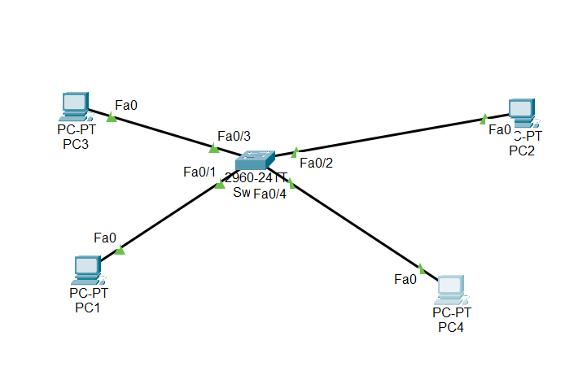
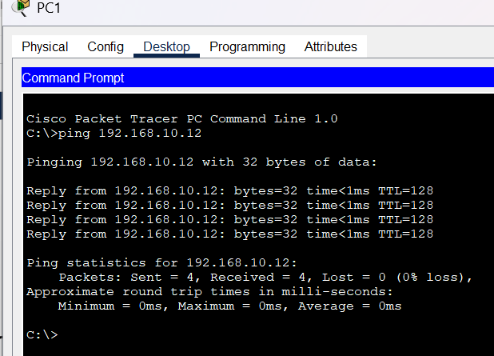
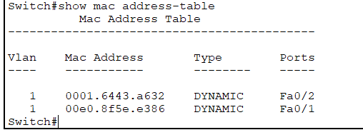

# Lab 02: Understanding MAC Address Learning
 
## 2.1 Explanation
 
A MAC (Media Access Control) address is a Layer 2 hardware address used to identify a network interface on an Ethernet LAN.
 
When an Ethernet frame arrives, the switch:
 
1. Examines its source MAC address.
2. Records the MAC address alongside the incoming port and VLAN.
3. Checks its MAC address table for the destination MAC address.
4. Forwards or floods the frame depending on whether the destination is known.
### Switch Forwarding Behaviour
 
| Situation                  | Switch Action                                                                       |
| -------------------------- | ----------------------------------------------------------------------------------- |
| Destination MAC is known   | Forwards the frame through the associated port within the same VLAN.                |
| Destination MAC is unknown | Floods the frame through eligible ports in the same VLAN, except the incoming port. |
| Broadcast destination      | Floods the frame within the same VLAN, except the incoming port.                    |
| Source MAC is received     | Learns or refreshes the source MAC-to-port association.                             |
 
## 2.2 Network Topology
 
The network consists of four PCs connected to a single Cisco 2960 switch using Ethernet cables.
 
### Device Configuration
 
| Device | IP Address    | Subnet Mask   |
| ------ | ------------- | ------------- |
| PC1    | 192.168.10.11 | 255.255.255.0 |
| PC2    | 192.168.10.12 | 255.255.255.0 |
| PC3    | 192.168.10.13 | 255.255.255.0 |
| PC4    | 192.168.10.14 | 255.255.255.0 |
 
All four PCs belong to the same subnet and are connected to the same switch. No router is required for communication between these devices.
 

 
## 2.3 Generate Traffic Between PCs
 
Before generating traffic, the switch may have an empty MAC address table because it has not yet learned the PCs' source MAC addresses.
 
On PC1, open Command Prompt and ping PC2:
 
```
C:\> ping 192.168.10.12
```
 
The ping generates network traffic between the two PCs. During this communication, the switch examines incoming Ethernet frames and learns the source MAC addresses.
 

 
## 2.4 Examine the MAC Address Table
 
Return to the switch CLI and enter:
 
```
Switch> enable
Switch# show mac address-table
```
 
The switch displays the MAC addresses it has learned, alongside their VLANs and corresponding switch ports.
 
### Understanding the MAC Address Table
 
| Column      | Meaning                                                                                                             |
| ----------- | ------------------------------------------------------------------------------------------------------------------- |
| VLAN        | The VLAN in which the MAC address was learned.                                                                      |
| MAC Address | The hardware address learned by the switch.                                                                         |
| Type        | How the entry was learned. Dynamic entries are learned automatically, while static entries are manually configured. |
| Ports       | The switch interface where the device was learned.                                                                  |
 

 
## 2.5 Observe Dynamic MAC Address Learning
 
I also explored the dynamic MAC address table using:
 
```
Switch# show mac address-table dynamic
```
 
Unlike the general MAC address table command, this filters the output to display only dynamically learned entries.
 
I learned that switches automatically discover MAC addresses by examining incoming Ethernet frames. They do not require an administrator to manually register every connected device.
 
Dynamic entries also have an aging timer. If no traffic is received from a particular MAC address within the configured period, the switch can remove that entry.
 
## 2.6 What I Learned
 
- A switch learns MAC addresses from the **source MAC address** of incoming Ethernet frames.
- The MAC address table stores the MAC address, VLAN and switch port associated with a device.
- When a destination MAC address is known, the switch forwards the frame through the corresponding port.
- When a destination MAC address is unknown, the switch floods the frame within the same VLAN, excluding the incoming port.
- Dynamic MAC addresses are learned automatically, while static MAC addresses are manually configured.
- ARP resolves IP addresses to MAC addresses, allowing devices to communicate over an Ethernet LAN.
