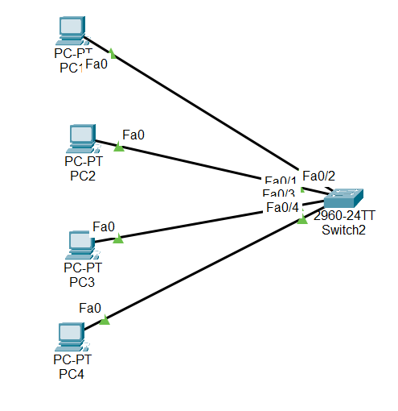
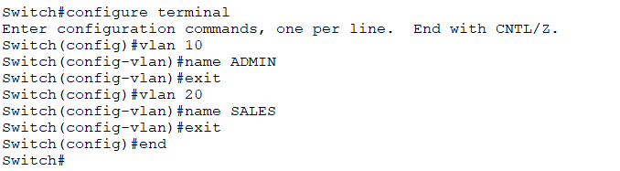
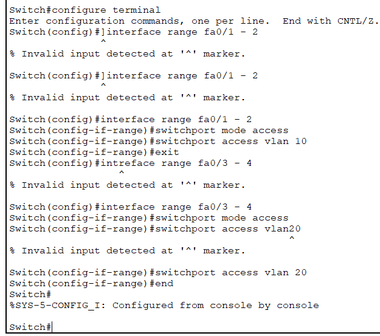
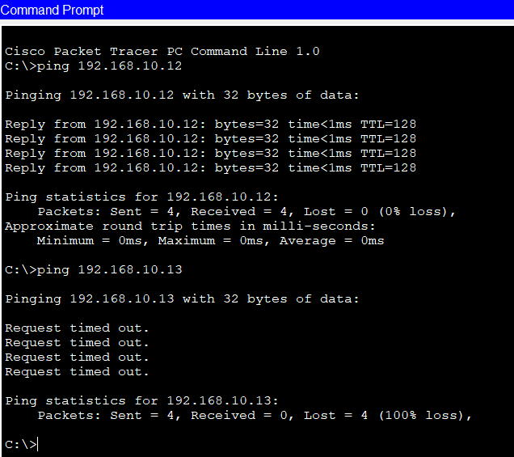

# Lab 03: Create and Configure VLANs

## 3.1 Network Topology

## 3.2 Creating and Naming VLANs

## 3.3 Assigning Ports to VLANs

## 3.4 Testing Connectivity

### Same VLAN

PC1 successfully pings PC2 because both devices belong to VLAN 10.

### Different VLANs

PC1 cannot ping PC3 because they belong to different VLANs and no Layer 3 device is configured to route traffic between them.

## 3.5 What I Learned

- VLANs (Virtual Local Area Networks) logically divide one physical switched network into separate Layer 2 broadcast domains.
- VLAN segmentation helps reduce unnecessary broadcast traffic and provides logical separation between devices on a network.
- Devices in the same VLAN can communicate at Layer 2 when correctly configured and addressed.
- Devices in different VLANs cannot communicate directly through a Layer 2 switch. They require inter-VLAN routing.
- A VLAN can be created using the `vlan` command followed by its ID. For example, `vlan 10` creates VLAN 10.
- The `name` command assigns a readable name to a VLAN.
- The `interface range` command allows multiple switch ports to be configured together.
- `switchport mode access` configures a port as an access port.
- `switchport access vlan` assigns an access port to a specific VLAN.
- The `show vlan brief` command displays VLANs and their assigned ports.
