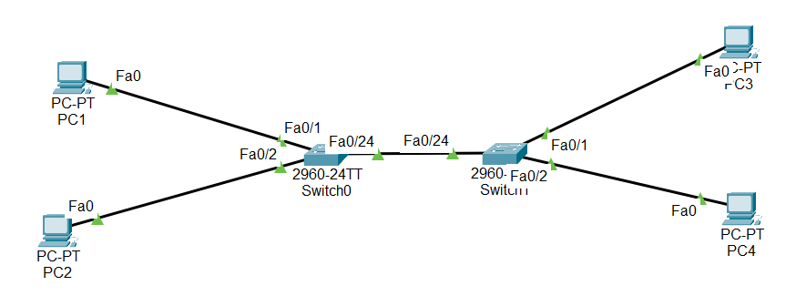
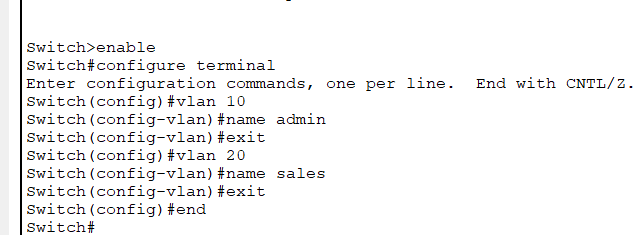
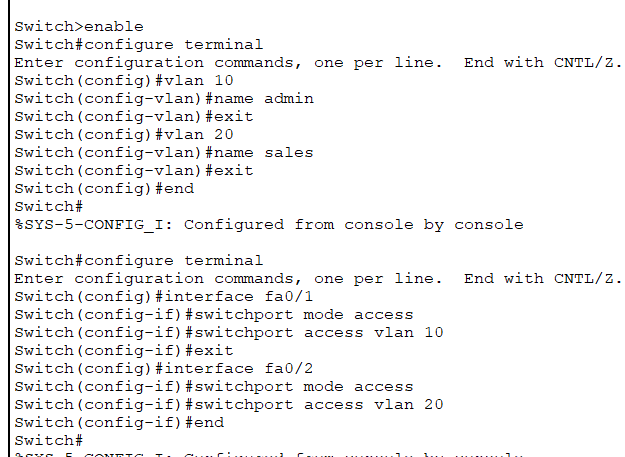
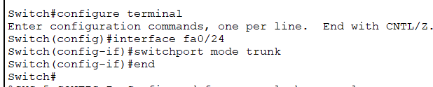
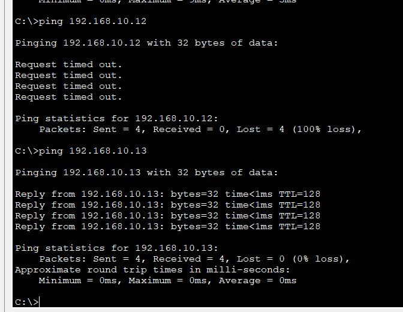

# Lab 04: Configure Trunk Ports

## 4.1 Network Topology

## 4.2 Creating and Naming VLANs on Both Switches

Create VLAN 10 (ADMIN) and VLAN 20 (SALES) on both SW1 and SW2.

## 4.3 Assigning Access Ports on Both Switches

Assign Fa0/1 to VLAN 10 and Fa0/2 to VLAN 20 on both switches.

## 4.4 Configuring Trunk Ports

Configure Fa0/24 as a trunk port on both SW1 and SW2 to carry traffic for multiple VLANs across the connection.

## 4.5 Verifying Trunk Configuration

Use `show interfaces trunk` to verify that Fa0/24 is operating as a trunk port.

## 4.6 Testing Connectivity

### Same VLAN Across Switches

PC1 successfully pings PC3 because both devices belong to VLAN 10, even though they are connected to different switches.

PC2 also successfully pings PC4 because both devices belong to VLAN 20.

### Different VLANs

PC1 cannot ping PC2 because they belong to different VLANs and no Layer 3 device is configured to route traffic between them.

## 4.7 What I Learned

- A trunk port carries traffic for multiple VLANs over a single physical connection.
- IEEE 802.1Q identifies the VLAN associated with Ethernet frames using VLAN tags.
- The native VLAN is carried untagged on a standard 802.1Q trunk.
- Trunk links allow devices in the same VLAN to communicate across different switches.
- VLANs must exist on both switches for the switches to carry their traffic correctly.
- Access ports connect end devices to a specific VLAN.
- `switchport mode trunk` configures an interface as a trunk port.
- `show interfaces trunk` displays the trunk ports and their VLAN information.
- Devices in different VLANs require inter-VLAN routing to communicate.
